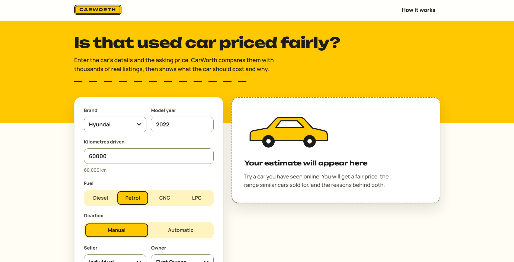
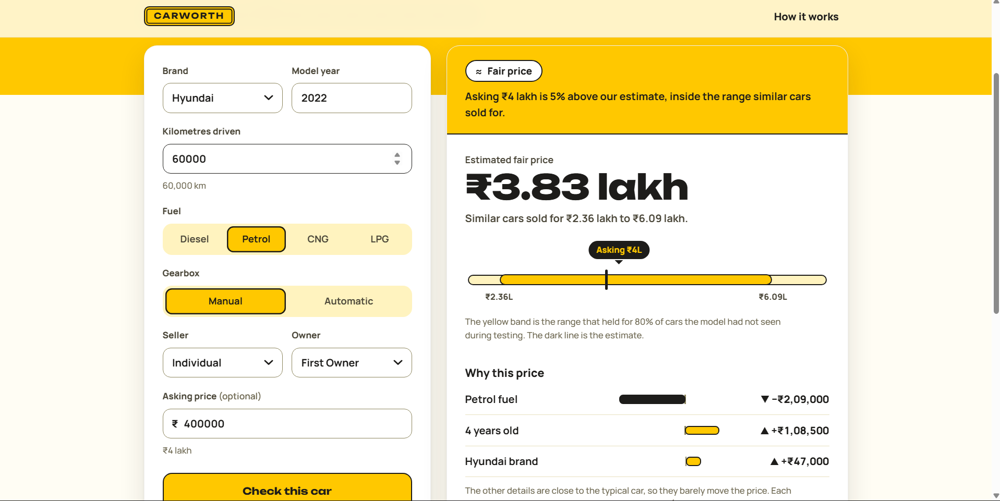
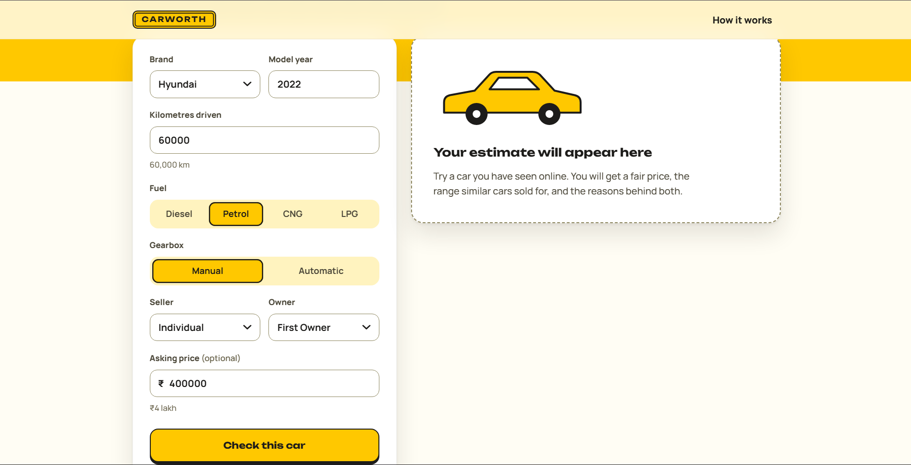

# CarWorth

Is that used car priced fairly? Enter a car's details and the asking price. CarWorth estimates what the car should cost,
shows the range similar cars sold for, explains what pushes the price up or down, and estimates what it will be worth
in three years.

**Stack:** Python, scikit-learn, pandas, FastAPI, vanilla JavaScript, Docker, GitHub Actions

## Screenshots

**1. Enter a car's details**



**2. Get a fair price, a range, a verdict and the reasons**



**3. See how accurate the model really is**



## What you get for each car

- **A fair price** with a **range**. The range comes from the model's own errors on cars it had not seen, so it is
  checked, not guessed.
- **A verdict** when you add an asking price: good deal (under the range), fair (inside it) or overpriced (over it).
- **Why this price:** how much each detail (age, kilometres, brand, fuel and so on) moves the price compared with a
  typical car.
- **Worth later:** an estimate for the next three years.
- **A "How it works" panel** in the app that shows the models compared, their errors and the limits of the data.

## How it works

```
CarDekho CSV -> clean (drop duplicates and impossible rows) -> features (age, km, brand, fuel, ...)
   -> compare 4 models with cross-validation -> pick the best -> measure on a held-out test set
   -> save model + metrics -> FastAPI serves it -> web page asks for estimates
```

- **Cleaning.** The public file repeats many listings. Duplicates are removed first, otherwise the same car can sit in
  both the training and test sets and make the results look better than they are.
- **Target.** Prices are skewed, so the model learns the logarithm of the price and converts back to rupees.
- **Four models compared:** a baseline that always guesses the median price, ridge regression, a random forest and
  gradient boosting. The best one by cross-validated error is chosen. The baseline shows how much the others add.
- **Honest measurement.** Choosing uses cross-validation on the training data. The numbers in the app come from a test
  set that was never used for choosing.
- **The range.** The middle 80% of the model's out-of-fold errors, expressed as ratios, becomes the price range. Its
  coverage is then checked again on the untouched test set.
- **Reasons.** For each detail, the model prices the car again with that one detail swapped for the typical value. The
  difference is the effect. It is easy to explain and needs no extra library, but the effects do not add up exactly.
- **Later value.** The car is priced again as 1, 2 and 3 years older, driven at its own average kilometres per year.

## Run it

### Option A: Docker (recommended)

```bash
docker compose build

# 1. Try it right away on made-up demo data (labelled "Demo data" in the app)
docker compose run --rm carworth python -m app.train --demo
docker compose up
# open http://localhost:8000
```

### Option B: real data (do this for your results)

1. Download `CAR DETAILS FROM CAR DEKHO.csv` from the Kaggle dataset "Vehicle dataset from CarDekho" (a free Kaggle
   account is needed) and save it as `backend/data/cardekho.csv`.
2. Train and start:

```bash
docker compose run --rm carworth python -m app.train
docker compose up
```

Restart the server (`Ctrl+C`, then `docker compose up`) after every training run so it loads the new model.

### Option C: without Docker

```bash
cd backend
python -m venv .venv && .venv\Scripts\activate      # on macOS/Linux: source .venv/bin/activate
pip install -r requirements-dev.txt
python -m app.train --demo        # or: python -m app.train   (with data/cardekho.csv in place)
uvicorn app.main:app --reload
```

**Tests:** `cd backend && pytest` (16 tests; they use made-up data and run in a couple of seconds).

## API

| Method | Route | Purpose |
|---|---|---|
| GET | `/api/options` | Brands, fuels and other choices the model knows |
| POST | `/api/estimate` | Price, range, verdict, reasons and three-year forecast for one car |
| GET | `/api/model-info` | Models compared, errors, cleaning counts, limits |
| GET | `/api/health` | Server status and whether a model is loaded |

Interactive docs at `/docs` while the server is running.

## Results

Trained on the public CarDekho used-car file. Of 4,340 listings, 763 were exact duplicates and 2 had impossible
values, leaving 3,575 for training and testing (80/20 split). "Typical error" means half of the predictions were
within that percentage of the real price.

| Model | Typical error (cross-validation) | Typical error (test) |
|---|---|---|
| Baseline (always the median price) | 47.0% | 48.5% |
| Ridge regression (chosen) | 24.2% | 25.8% |
| Random forest | 24.8% | 25.5% |
| Gradient boosting | 24.6% | 25.2% |

- The models cut the typical error roughly in half compared with always guessing the median price.
- The three real models are within about a percentage point of each other, which is too close to call on 715 test
  cars. Ridge was chosen by cross-validation on the training data, not by looking at the test set.
- The 80% price range held for 80% of cars the model had never seen.
- Removing the 763 duplicates matters: left in, the same car can land in both the training and test sets and make the
  results look better than they are.

## Limits (read before trusting a number)

- **The prices are from a snapshot** of listings around the year the data was collected, so today's prices may differ.
  Use CarWorth to compare cars, not as an exact quote.
- **Listing prices are asking prices**, not final sale prices.
- **The error is about 25%**, so the 80% price range is wide and the verdict is lenient. It flags clear outliers,
  not small gaps.
- **The data has the brand but not the model name**, so a Maruti 800 and a Maruti Ciaz look the same to the model.
  Adding the model name is the most likely way to lower the error.
- **It cannot see** condition, accident history, city or the exact variant, only brand, age, kilometres, fuel, seller,
  gearbox and owner count.
- **The three-year forecast** compares cars of different ages. It does not follow one car through time.
- **Cars unlike the training data** (very old, very high mileage, rare brands) get a warning in the app.

## Project layout

```
backend/app/data.py       cleaning and features
backend/app/modeling.py   training, comparison, price range
backend/app/predict.py    estimate, reasons, forecast
backend/app/main.py       FastAPI app and static files
backend/app/train.py      command-line training
backend/app/static/       the web page (HTML, CSS, JavaScript)
backend/tests/            pytest suite
```

## Ideas for next steps

Add the extra columns from the larger CarDekho file (mileage, engine, power, seats), try per-brand models, show a
price-versus-age chart for the chosen brand, and retrain on fresher listings.

Built with Claude as a coding assistant.
